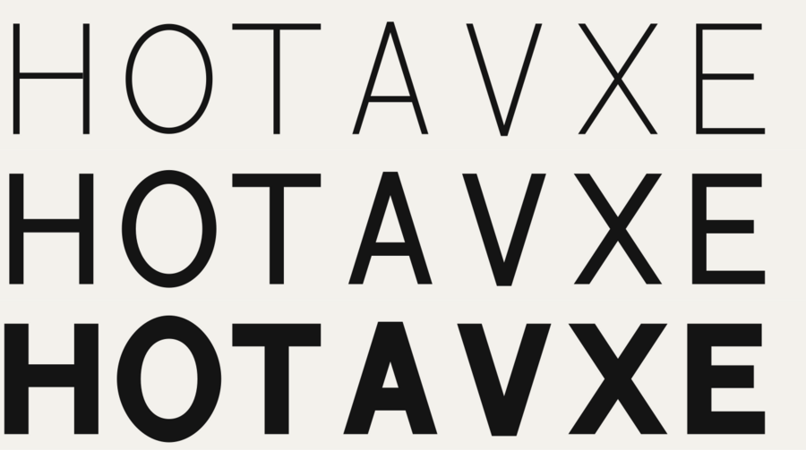
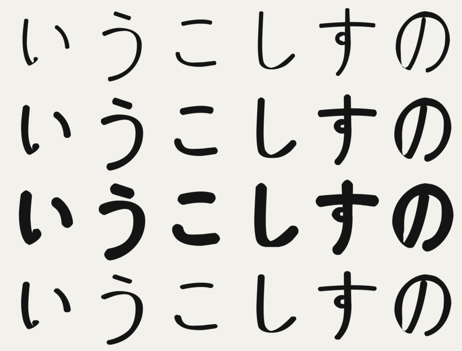

# whgtctl

Illustrator の塗りパスで組んだオリジナル書体（欧文・ひらがな）に、ウェイト変更・太さの均一化・縦横比の調整・光学補正をかけるスクリプトです。




## 構成

| パス | 内容 |
| --- | --- |
| `scripts/OpticalCorrection.jsx` | Illustrator 用スクリプト本体（ExtendScript / ES3、UTF-8 BOM 付き） |
| `mock/Main.dc.html` | 検討用のインタラクティブモック（Claude の Design キャンバス用のファイル。単体のブラウザでは動きません） |
| `tests/run-mock-illustrator.js` | Node 上で Illustrator のオブジェクトを模して計算部分を検証するスクリプト |
| `tests/sample-input.js` | 検証用のサンプル文字（H O T A V X E / い う こ し す の） |
| `docs/prompts.md` | 作成時のプロンプト履歴 |
| `docs/images/` | 検証結果の画像 |

## 使い方

1. 1 文字を 1 グループにまとめた文字を選択します（複数可）。
   グループに入っていないパスを選んだ場合は、それらをまとめて 1 文字として扱います。
2. 「ファイル > スクリプト > その他のスクリプト…」で `OpticalCorrection.jsx` を実行します。
3. ダイアログで調整し、プレビューで確認して OK。キャンセルで元に戻ります。

- 対象は塗りのある閉じたパス（複合パス・クリップグループの中身を含む）です。線だけのパス、開いたパス、クリッピングパスは変更しません。
- 1 回の実行で選んだ文字は同じ書体とみなし、標準ステム（StdVW / StdHW）を共通で求めます。
- ベースラインと上端（キャップハイト、かなは字面の上下）は、選択した文字の下端・上端の最頻値から自動で入ります。ダイアログで修正できます。
- プレビューのたびに取り消し履歴が増えるため、複製した文字で試すのが安全です。

### 調整項目

| 区分 | 項目 |
| --- | --- |
| ウェイト | Thin〜Black のボタン、縦画の太さ（元の StdVW 比）、カウンター保護（最小の空き）、カウンター保持（字幅で吸収） |
| 太さの均一化 | 揃える強さ、揃える範囲（基準からのずれ） |
| 縦横の比率 | 横画 / 縦画、斜画を細く |
| 光学補正・精度 | オーバーシュート（頂点・曲線）、光学的中心（中央の横画）、曲線の許容誤差 |

## アルゴリズム

1. **正規化と前処理**：メトリクス高さを 700u に正規化。曲線を x / y 極値で分割（フォント制作の定石。測定と変形の精度が上がる）。
2. **画の測定**：輪郭上の各点から内向き法線方向にレイを飛ばし、塗りの外へ出るまでの距離を幅とする。外向きにも飛ばしてカウンターの空きを測る。直線の辺は辺全体の中央値、曲線は移動中央値。
3. **関係の判定**：他の塗りに隠れた辺／重なって一致する辺（相手の辺に追従）、メトリクスに乗った辺（固定）、端（キャップ）、オーバーシュート候補（曲線の頂部・尖った頂点）、光学的中心の対象（中央付近の長い横画）。
4. **標準ステム**：直線の縦画・横画と、曲線の極値での幅から StdVW / StdHW を求める（ヒンティングのステム検出と同じ考え方）。
5. **目標の太さ（縦横の異方性モデル）**：縦画の目標 = StdVW × ウェイト、横画の目標 = 縦画の目標 × 横縦比。斜画や曲線は法線の向き（nx², ny²）で補間。均一化は「揃える範囲」内のずれだけを目標へ寄せる。
6. **カウンター保護**：太らせる量を、空きが最小幅を下回らない範囲に制限。
7. **変形**：直線の辺は平行移動、角は両隣のオフセット線の交点（マイター）。曲線は Tiller–Hanson 法で制御点を求め、真のオフセットとの誤差が許容値を超えたときだけ分割。

### 参考にした手法

- [Glyphs Handbook: Offset Curve](https://handbook.glyphsapp.com/filters/offset-curve/) — 横・縦を別々にオフセット
- [Glyphs Forum: Is there a magical way to make stems thinner/thicker](https://forum.glyphsapp.com/t/is-there-a-magical-way-to-make-stems-thinner-thicker/30081) — 単純なオフセットは画の太さを知らない
- [FontLab: Creating a Bold Font](https://support.fontlab.com/support/solutions/articles/33000205895/thumbs_up) — 太い画ほど速く太る
- [foundrytools: otf_recalc_stems](https://foundrytools.readthedocs.io/en/stable/_modules/foundrytools/app/otf_recalc_stems.html) — StdVW / StdHW の算出
- [Offset curve approximation (Patrikalakis & Maekawa)](https://web.mit.edu/hyperbook/Patrikalakis-Maekawa-Cho/node222.html) — Tiller–Hanson 法と誤差による分割
- [GPU-friendly Stroke Expansion (Levien & Uguray)](https://ar5iv.labs.arxiv.org/html/2405.00127) — 曲線オフセットの誤差評価

## 検証

```sh
node tests/run-mock-illustrator.js   # tests/out/*.svg を出力
```

Illustrator 実機での動作は未確認です。

## 既知の制限

- 1 本の画の中の意図的な太さの変化（毛筆的な抑揚など）は、均一化を強くかけると平らになります。
- 画どうしが近い字を大きく太らせると、カウンター保護をかけても窮屈になります。
- カウンター保持は、文字の中心から左右に押し広げる単純な方式です。
- 極値に点がない曲線には点を追加します。極端なウェイトでは曲線の分割で点が増えることがあります。
- ExtendScript は処理が遅いため、文字数が多いと解析とプレビューに時間がかかります。
