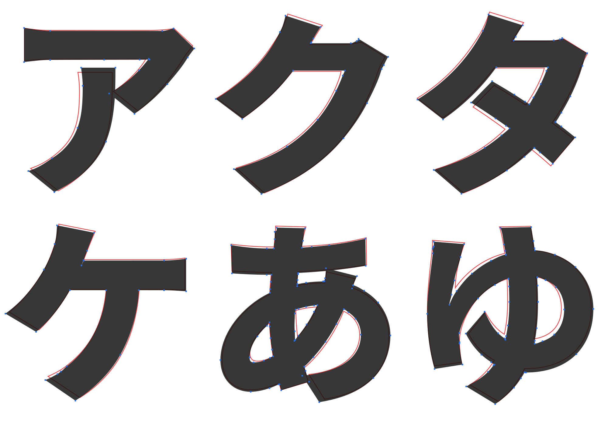

# whgtctl

Illustrator の塗りパスで組んだオリジナル書体（欧文・ひらがな）に、ウェイト変更・太さの均一化・縦横比の調整・光学補正をかけるスクリプトです。


## 構成

| パス | 内容 |
| --- | --- |
| `scripts/OpticalCorrection.jsx` | Illustrator 用スクリプト本体（ExtendScript / ES3、UTF-8 BOM 付き） |
| `mock/Main.dc.html` | 検討用のインタラクティブモック（Claude の Design キャンバス用のファイル。単体のブラウザでは動きません） |
| `tests/run-mock-illustrator.js` | Node 上で Illustrator のオブジェクトを模して計算部分を検証するスクリプト |
| `tests/sample-input.js` | 検証用のサンプル文字（H O T A V X E / い う こ し す の） |
| `demo/noto-kana.html` | Noto Sans JP のひらがな・カタカナ・英数字で試すページ（Regular から合成し、本物の Thin / Bold / Black と比較） |
| `tools/noto/` | 上のページの作成と、本物の字形との一致度（IoU）を測るスクリプト |
| `docs/prompts.md` | 作成時のプロンプト履歴 |
| `docs/images/` | 検証結果の画像 |

## 使い方

1. 「ファイル > スクリプト > その他のスクリプト…」で `OpticalCorrection.jsx` を実行します。何も選んでいなくても開けます。
   開いたパネルは閉じるまで残り、そのまま書類を操作できます。
2. 1 文字を 1 グループにまとめた文字を選択し（複数可）、「選択を読み込む」を押します。
   グループに入っていないパスは、離れた塊ごとに 1 文字として扱います。
3. スライダーで調整します（その場でプレビュー）。「適用（確定）」で確定、「元に戻す」で読み込む前に戻ります。
4. 続けて別の文字を選択し、「選択を読み込む」から繰り返せます。確定していないプレビューは、次の読み込みやパネルを閉じたときに元に戻ります。

- プレビュー中は、元の文字を隠して複製を変形しています（どちらにも `whgtctl` の印が付きます）。確定すると元の文字を削除します。
- 対象は塗りのある閉じたパス（複合パス・クリップグループの中身を含む）です。線だけのパス、開いたパス、クリッピングパスは変更しません。
- 「頂点数を揃える（ウェイト間で互換）」がオン（既定）のとき、出力は元のパスと同じ点数・並び順・始点・点の種類になります。元のパスや他のウェイトと補間できます。オフにすると、精度のために極値への点の追加と曲線の分割を行います。
- 1 回の実行で選んだ文字は同じ書体とみなし、標準ステム（StdVW / StdHW）を共通で求めます。
- ベースラインと上端（キャップハイト、かなは字面の上下）は、選択した文字の下端・上端の最頻値から自動で入ります。パネルで修正できます。
- プレビューのたびに取り消し履歴が増えます。

### 線端（ターミナル）

| 項目 | 内容 |
|---|---|
| フレア | 線端に近いほど太らせる量（目標の線の太さに対する割合） |
| フレアの長さ | 広がりが始まる位置。線端から輪郭に沿って測る（線の太さに対する割合） |
| 線端の丸み | 線端の辺を弧にする。100% で半円に近い形。線の長さは変えない |
| 線端の角度 | 線端の辺を中心で回す |
| 水平・垂直に揃える | 線端の辺を一番近い水平か垂直に揃える |

### 頂点数

| 設定 | 内容 |
|---|---|
| ウェイト間で揃える（精度優先・既定） | 元の形だけで決まる位置（極値、大きく曲がる所）に点を足し、重なった点は外す。どのウェイトでも同じ点数・同じ並びになる |
| 元と同じ | 元のパスと同じ点数・並び・始点・点の種類で書き戻す |
| 揃えない | 精度のために必要なだけ曲線を分割する |

### 調整項目

| 区分 | 項目 |
| --- | --- |
| ウェイト | Thin〜Black のボタン、縦画の太さ（元の StdVW 比）、カウンター保護（最小の空き）、カウンター保持（字幅で吸収）、線端の伸び |
| 太さの均一化 | 揃える強さ、揃える範囲（基準からのずれ） |
| 縦横の比率 | 横画 / 縦画、斜画を細く |
| 光学補正・精度 | オーバーシュート（頂点・曲線）、光学的中心（中央の横画）、曲線の許容誤差 |

## アルゴリズム

1. **正規化と前処理**：メトリクス高さを 700u に正規化。曲線を x / y 極値で分割（フォント制作の定石。測定と変形の精度が上がる）。
2. **画の測定**：輪郭上の各点から内向き法線方向にレイを飛ばし、塗りの外へ出るまでの距離を幅とする。外向きにも飛ばしてカウンターの空きを測る。直線の辺は辺全体の中央値、曲線は移動中央値。
3. **関係の判定**：他の塗りに隠れた辺／重なって一致する辺（相手の辺に追従）、メトリクスに乗った辺（固定）、端（キャップ）、オーバーシュート候補（曲線の頂部・尖った頂点）、光学的中心の対象（中央付近の長い横画）。
4. **標準ステム**：直線の縦画・横画と、曲線の極値での幅から StdVW / StdHW を求める（ヒンティングのステム検出と同じ考え方）。
5. **目標の太さ（縦横の異方性モデル）**：縦画の目標 = StdVW × ウェイト、横画の目標 = 縦画の目標 × 横縦比。斜画や曲線は法線の向き（nx², ny²）で補間。均一化は「揃える範囲」内のずれだけを目標へ寄せる。
6. **カウンター保護**：太らせる量を、空きが最小幅を下回らない範囲に制限。
7. **変形**：直線の辺は平行移動、角は両隣のオフセット線の交点（マイター）。曲線は真のオフセット上の点列に、端点と端の接線方向を固定した 3 次ベジェを最小二乗で当てはめ（Schneider 法）、誤差が許容値を超えたときだけ分割。
8. **後処理**：オフセットで向きが反転した辺を畳んでスワローテールを除去。つなぎ目の短い辺は自前で測らず前後から補間。なめらかにつながる曲線どうしは区間をまたいでオフセット量をならす。線端は太った量の一定割合だけ外へ伸ばす。

### 参考にした手法

- [Glyphs Handbook: Offset Curve](https://handbook.glyphsapp.com/filters/offset-curve/) — 横・縦を別々にオフセット
- [Glyphs Forum: Is there a magical way to make stems thinner/thicker](https://forum.glyphsapp.com/t/is-there-a-magical-way-to-make-stems-thinner-thicker/30081) — 単純なオフセットは画の太さを知らない
- [FontLab: Creating a Bold Font](https://support.fontlab.com/support/solutions/articles/33000205895/thumbs_up) — 太い画ほど速く太る
- [foundrytools: otf_recalc_stems](https://foundrytools.readthedocs.io/en/stable/_modules/foundrytools/app/otf_recalc_stems.html) — StdVW / StdHW の算出
- [Offset curve approximation (Patrikalakis & Maekawa)](https://web.mit.edu/hyperbook/Patrikalakis-Maekawa-Cho/node222.html) — オフセット曲線の近似手法の比較（最小二乗法が全般に良好）、誤差による分割
- [GPU-friendly Stroke Expansion (Levien & Uguray)](https://ar5iv.labs.arxiv.org/html/2405.00127) — 曲線オフセットの誤差評価

## 検証

```sh
node tests/run-mock-illustrator.js   # サンプル文字で動作確認（tests/out/*.svg）
cd tools/noto && node metric.js      # Noto Sans JP の本物のウェイトとの IoU（kana.json が必要）
```

Noto Sans JP のひらがな・カタカナ約 90 字で、Regular から合成した字形と本物の字形の IoU（重なった面積 ÷ どちらかが塗られた面積）：

| 比較先 | 変形なし | 合成 | 下位 10% |
| --- | --- | --- | --- |
| Thin | 0.384 | 0.735 | 0.617 |
| Bold | 0.621 | 0.922 | 0.896 |
| Black | 0.512 | 0.898 | 0.862 |

英数字 62 字（頂点数を揃えるモード）：Thin 0.699、Bold 0.905、Black 0.875。どのウェイトでもアンカー数は入力と同じ（かな 2142、英数字 825）。



本物の Black と残る差の多くは、画の位置の移動やつなぎ目の切り込みといった字形デザインの違いで、太さの調整では再現できません。

Illustrator 実機での動作は未確認です。

## 既知の制限

- 1 本の画の中の意図的な太さの変化（毛筆的な抑揚など）は、均一化を強くかけると平らになります。
- 画どうしが近い字を大きく太らせると、カウンター保護をかけても窮屈になります。
- カウンター保持は、文字の中心から左右に押し広げる単純な方式です。
- テスト用サンプル（`tests/sample-input.js`）のかなは、自己交差する輪郭を含むため「の」などで形が乱れます。実際のフォントでは起きにくい形です。
- 極値に点がない曲線には点を追加します。極端なウェイトでは曲線の分割で点が増えることがあります。
- ExtendScript は処理が遅いため、文字数が多いと解析とプレビューに時間がかかります。

## ライセンス表記

`demo/noto-kana.html` には Noto Sans JP（SIL Open Font License 1.1）から取り出した輪郭データが含まれます。
